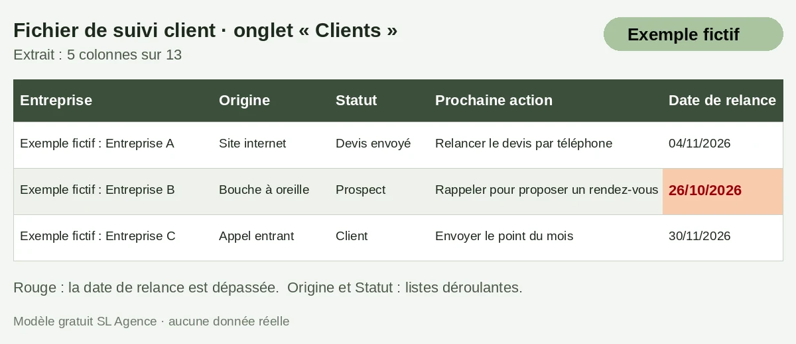
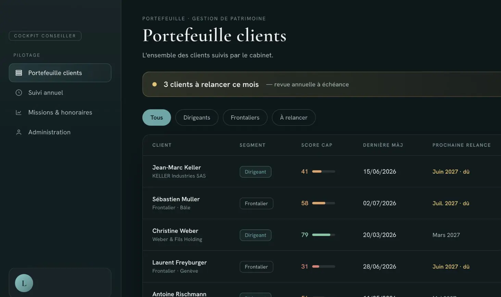

# NOTES POUR seo-site (à ne pas publier)

- Le contenu publiable commence à la ligne « Corps de l'article ». Tout ce qui précède est du pilotage.
- Title et meta : recompter par script avant intégration (c020). Version de repli (tableau HTML à copier au lieu du `.xlsx`) : remplacer aussi, dans le corps, le bouton de téléchargement par le tableau et retirer « .xlsx », « sans macro » et « onglet Mode d'emploi ».
- Fichier : `/modeles/modele-fichier-suivi-client.xlsx` (bouton de téléchargement, partie « Le modèle gratuit »). Aperçu : `/img/blog/apercu-fichier-suivi-client.webp` (alt et légende ci-dessous). Le texte du corps suppose que le fichier contient EXACTEMENT les 13 colonnes listées, 3 lignes « Exemple fictif », un onglet « Mode d'emploi » avec la règle CNIL et ses conditions, aucune macro : à vérifier à l'ouverture et à corriger côté texte si le fichier diffère. Rien n'est écrit sur Google Sheets (non testé).
- Image `/capture-portefeuille.webp` : fallback `/capture-portefeuille.jpg`, `width="1463" height="869"`, `loading="lazy"` (comme sur realisations.html).
- Balisage `Article` (author = Person, datePublished, dateModified) + `FAQPage` (les 4 questions, réponses identiques au texte visible, phrase CNIL avec ses conditions, c022) + `BreadcrumbList`. Aucune mention de prix ni d'éditeur.
- Liens internes du corps (ancres) : `/crm-sur-mesure` (« CRM sur mesure pour PME », 2 fois : encart et conclusion), `/remplacer-excel` (« remplacer Excel par une application »), `/blog/limites-excel-entreprise` (« Excel ne suffit plus dans votre entreprise ? 7 signes qui ne trompent pas »), `/blog/relancer-un-devis-sans-reponse` (« relancer un devis sans réponse »), `/relance-factures-automatique` (« relance automatique de factures »), `/modeles-gratuits` (« modèles gratuits »), `/realisations#bureau` (« la réalisation »).
- Le bouton « Réserver un appel de 15 minutes » de l'encart relève du gabarit du site (ancre `#rendez-vous` ou équivalent). Téléphone : 07 67 08 19 43.
- Le texte de la réalisation (gestion de patrimoine) est repris mot pour mot de `realisations.html` l.849-851 ; la mise en garde est reprise mot pour mot de `crm-sur-mesure.html` l.873 ; la seconde phrase d'avertissement reprend celle de l.888 sans les mots « décrits plus haut » (qui n'ont pas de sens ici).
- Mise à jour : l'URL doit répondre en 200 avant la publication du post Google (06/11).

# Corps de l'article

# CRM ou Excel : que choisir pour une TPE ? Les 5 questions à se poser, et un modèle gratuit.

*Par Loïc Bitsch, associé de SL Agence · Publié le 2 novembre 2026 · 8 min de lecture*

*Mis à jour le 2 novembre 2026*

**Notre avis.** Excel suffit tant que 1 ou 2 personnes tiennent le fichier et qu'aucune relance ne s'oublie. Un CRM devient plus sûr quand plusieurs personnes suivent les mêmes clients ou des devis en cours. Le fichier de suivi client gratuit est plus bas, dans la partie « Le modèle gratuit ».

> **En bref**
> - Un CRM est un outil de gestion de la relation client : une fiche par client, avec l'historique et les relances.
> - Excel suffit pour un suivi simple, tenu par peu de personnes.
> - 5 questions aident à décider (repère SL Agence, pas une norme).
> - Un fichier Excel de suivi client est à télécharger, sans inscription.

## Excel ou CRM : quelle différence pour suivre ses clients ?

CRM veut dire « gestion de la relation client ». Un CRM est un outil qui réunit, pour chaque client, ses coordonnées, l'historique des échanges et la prochaine action à mener. Un fichier Excel peut tenir le même rôle, à condition que quelqu'un le remplisse et le relise.

Voici Excel et un CRM du marché sur 6 points. Les cases « selon l'éditeur » se vérifient chez chaque éditeur : ce tableau n'en cite aucun.

| Pour suivre vos clients | Excel | CRM du marché |
|---|---|---|
| Historique des échanges | À noter vous-même, dans une colonne « Notes » | Une fiche par client qui garde les échanges, selon l'éditeur |
| Rappel de relance | Une date dans une colonne, à regarder régulièrement | Rappel prévu par l'outil, selon l'éditeur |
| Une même fiche, plusieurs personnes | Possible avec un fichier partagé en ligne ; il faut convenir de qui modifie quoi | Prévu pour plusieurs utilisateurs, selon l'éditeur |
| Ouvrir la fiche depuis un téléphone | Peu lisible : un tableau large se lit mal sur un petit écran | Selon l'éditeur |
| Coût de départ | Aucun si vous avez déjà Excel | Abonnement, selon l'éditeur |
| Récupérer vos données | Le fichier est déjà chez vous | À demander : peut-on tout exporter, et dans quel format ? |

## Quand Excel suffit encore à une TPE

Selon nous, Excel est un bon point de départ : noter ses clients vaut mieux que les garder en tête. Il suffit encore dans ces 4 situations :

- **1 ou 2 personnes tiennent le fichier**, et elles se parlent tous les jours.
- **Les clients à suivre restent assez peu nombreux** pour que vous les retrouviez sans chercher.
- **Vous regardez la colonne « Date de relance » chaque semaine**, et aucune relance ne passe à la trappe.
- **Votre vente est simple** : pas de devis en attente de réponse pendant des semaines.

Quand ces situations ne sont plus les vôtres, les signes se voient. Notre article [Excel ne suffit plus dans votre entreprise ? 7 signes qui ne trompent pas](/blog/limites-excel-entreprise) les détaille, dont les données clients éparpillées.

## 5 questions pour savoir s'il est temps de passer à un CRM

Comptez 1 point à chaque situation qui est la vôtre. C'est un repère SL Agence, pas une norme.

1. **Plusieurs personnes écrivent dans le fichier.** Pour savoir qui modifie quoi, il faut se parler.
2. **Une relance a déjà été oubliée.** Voir comment [relancer un devis sans réponse](/blog/relancer-un-devis-sans-reponse).
3. **Pour retrouver l'historique d'un client, vous ouvrez plusieurs fichiers.**
4. **Vous suivez des devis en cours**, dont certains attendent une réponse.
5. **Vous avez besoin du fichier hors du bureau**, chez un client ou en déplacement.

**Comment lire le résultat.** Repère SL Agence : 0 point, Excel suffit encore. 1 ou 2 points, améliorez d'abord le fichier avec le modèle plus bas. 3 points ou plus, comparez des CRM.

> **Ni Excel ni un CRM du marché ne colle à votre façon de vendre ?** Nous construisons un CRM autour de votre fichier actuel. Voir notre page [CRM sur mesure pour PME](/crm-sur-mesure). Le premier outil est en place en 7 jours.
>
> **[Réserver un appel de 15 minutes]** ou appelez le 07 67 08 19 43.

## Le modèle gratuit : un fichier de suivi client Excel, prêt à remplir

Voici un fichier de suivi client en Excel, sans inscription et sans macro. Il garde le principe d'un CRM simple : 1 ligne par client, un statut, une date de relance.

**[Télécharger le fichier de suivi client (.xlsx)](/modeles/modele-fichier-suivi-client.xlsx)**

*Aperçu du fichier de suivi client, onglet « Clients ». Exemple fictif.*

**Les 13 colonnes de l'onglet « Clients » :**

- Entreprise
- Contact
- Fonction
- Téléphone
- E-mail
- Ville
- Origine (liste)
- Statut (liste : Prospect, Devis envoyé, Client, Perdu, Ne plus contacter)
- Dernier échange (date)
- Prochaine action
- Date de relance (en rouge si elle est dépassée)
- Revoir ou supprimer le (date à saisir vous-même)
- Notes

**Exemple fictif.** Les 3 lignes déjà remplies sont inventées (adresses en example.com, numéros en 06 00 00 00 00) : effacez-les avant de saisir vos vrais clients. Un second onglet, « Mode d'emploi », tient en quelques lignes.

**Combien de temps garder une ligne ?** Ce fichier contient des coordonnées de personnes : ce sont des données personnelles. Selon le référentiel de la CNIL sur la gestion des activités commerciales, les données relatives aux prospects utilisées à des fins de prospection commerciale peuvent être conservées 3 ans à compter de leur collecte ou du dernier contact émanant du prospect. Celles d'un client, utilisées aux mêmes fins, peuvent l'être pendant la relation commerciale, puis 3 ans après sa fin. Les référentiels de la CNIL ne sont pas contraignants, mais celui qui s'en écarte (par exemple avec une autre durée) doit pouvoir justifier son choix (source : CNIL, [« Questions-réponses sur les référentiels relatifs à la gestion des activités commerciales et des impayés dans une transaction commerciale »](https://www.cnil.fr/fr/questions-reponses-sur-les-referentiels-relatifs-la-gestion-des-activites-commerciales-et-des), page publiée le 28 janvier 2022, consultée le 2 novembre 2026).

Selon nous, remplissez la colonne « Revoir ou supprimer le » en même temps que la ligne : vous n'avez plus à y repenser ensuite.

D'autres fichiers sont à copier dans nos [modèles gratuits](/modeles-gratuits).

## Passer d'Excel à un CRM sans tout ressaisir

Si vous choisissez un CRM un jour, votre fichier vous servira de point de départ. Selon nous, 5 vérifications évitent de ressaisir :

- **Nettoyer les doublons.** La même entreprise écrite de 2 façons devient 2 fiches.
- **Garder les mêmes mots pour les statuts.** « Devis envoyé » partout, pas « devis parti » ici et « DE » là.
- **Séparer l'entreprise et le contact** sur 2 colonnes, comme dans le modèle.
- **Écrire les dates dans le même format**, par exemple 15/11/2026.
- **Poser 2 questions avant de choisir** : peut-on importer un fichier Excel ? Peut-on tout exporter ensuite ? La réponse dépend de chaque outil : demandez-la à l'éditeur.

Gardez aussi une copie du fichier d'origine tant que la reprise n'est pas vérifiée.

Pour réunir ses fichiers sur un seul écran, voir [remplacer Excel par une application](/remplacer-excel).

### Un exemple proche de nos réalisations

Un cabinet de gestion de patrimoine. Ce n'est pas présenté comme un CRM : c'est l'exemple le plus proche que nous ayons.

**Avant.** Un fichier Excel par client, rangé dans des dossiers. Pour préparer un rendez-vous : chercher, ouvrir, fermer, recommencer. Aucune vue d'ensemble.

**Ce que nous avons construit.** Une seule application pour les clients, les contrats et les échéances. Le questionnaire se remplit pendant le rendez-vous, le score se calcule en direct, la restitution s'imprime en sortant.

**Ce qui a changé.** Les clients à relancer sont signalés automatiquement. Le conseiller ne cherche plus, il consulte.

*L'application qui a remplacé les fichiers Excel d'un cabinet de gestion de patrimoine. Données fictives.*

Le suivi des devis est une fonction que nous pouvons construire : il ne fait pas partie de cet outil. Voir [la réalisation](/realisations#bureau).

## Conclusion : commencer par le fichier, passer au CRM quand les signes s'additionnent

Pour suivre ses clients en TPE, Excel est un bon début, selon nous. Gardez-le tant que 1 ou 2 personnes tiennent le fichier et que chaque relance se fait à sa date. Passez à un CRM quand plusieurs de ces situations se cumulent (3 points ou plus au test) : plusieurs personnes suivent les mêmes clients, des devis restent en attente, il vous faut le fichier hors du bureau.

Si aucun CRM du marché ne convient à votre façon de vendre, apportez-nous votre fichier : nous construisons un [CRM sur mesure pour PME](/crm-sur-mesure) autour de lui. Il suffit de 15 minutes au téléphone, au 07 67 08 19 43. Pour les factures impayées, c'est un autre sujet : voir la [relance automatique de factures](/relance-factures-automatique).

## Questions sur le choix entre CRM et Excel

### Peut-on faire un CRM sur Excel ?

Oui, pour un suivi simple : 1 ligne par client, un statut, une date de relance et des notes. C'est ce que fait le modèle de cet article. Selon nous, la limite est humaine : le fichier ne vous prévient pas, c'est vous qui le relisez.

### Un CRM gratuit suffit-il pour une TPE ?

Cela dépend de l'offre gratuite, propre à chaque éditeur et à lire sur sa page. Selon nous, 4 points à vérifier : le nombre d'utilisateurs permis, les fonctions comprises, la possibilité d'exporter toutes vos données, et ce qui change si vous dépassez l'offre gratuite.

### CRM ou ERP : quelle différence ?

Un CRM sert à suivre les clients : contacts, échanges, devis, relances. Un ERP est un logiciel de gestion qui couvre plusieurs fonctions de l'entreprise à la fois, comme la comptabilité, les achats ou les stocks. Selon nous, pour suivre ses clients, un fichier ou un CRM suffit, sans passer par un ERP.

### Combien de temps garder les coordonnées d'un prospect ?

Selon le référentiel de la CNIL sur la gestion des activités commerciales, qui n'est pas contraignant (s'en écarter doit pouvoir être justifié), les données des prospects utilisées à des fins de prospection commerciale peuvent être conservées 3 ans à compter de leur collecte ou du dernier contact émanant du prospect. Celles d'un client, utilisées aux mêmes fins, peuvent l'être pendant la relation commerciale, puis 3 ans après sa fin (source : CNIL, « Questions-réponses sur les référentiels relatifs à la gestion des activités commerciales et des impayés dans une transaction commerciale »).

**À propos de l'auteur.** Loïc Bitsch est associé de SL Agence, à Friesen (Haut-Rhin). SL Agence conçoit des applications métier, des automatisations et des assistants d'intelligence artificielle sur mesure pour les indépendants, TPE, PME, cabinets et associations.
